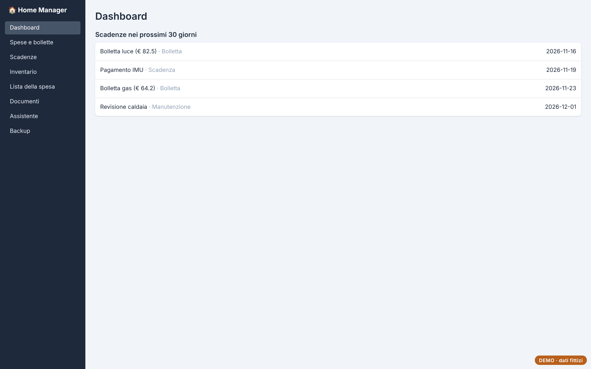
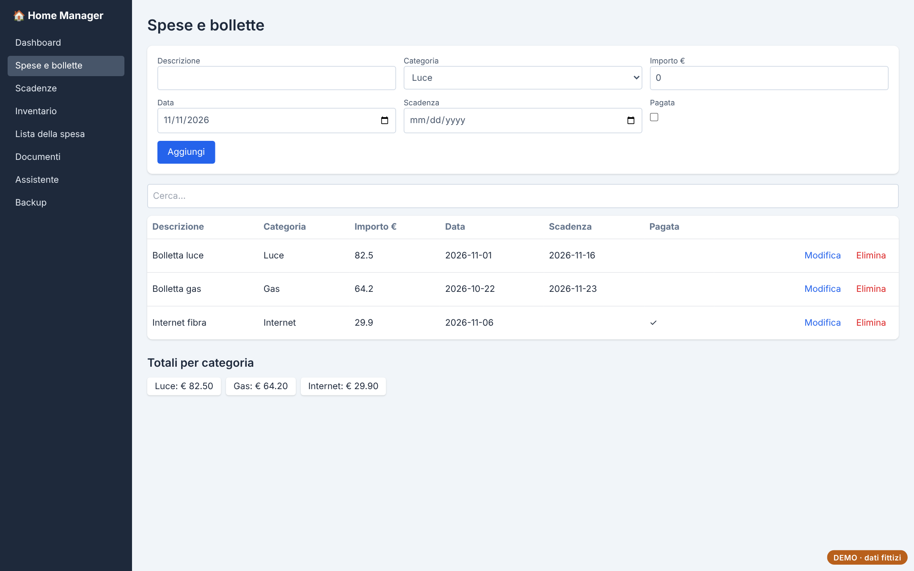
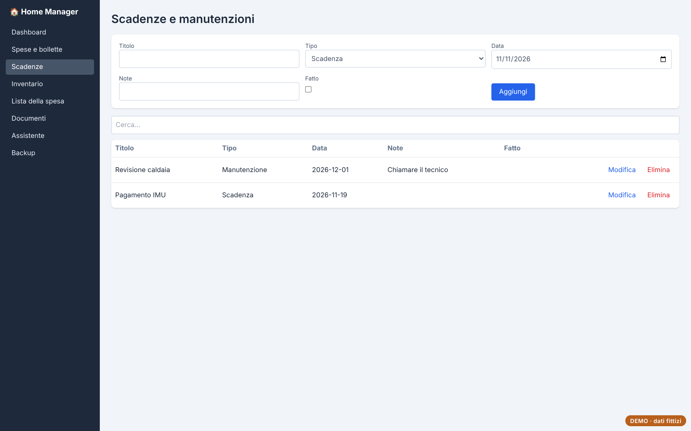
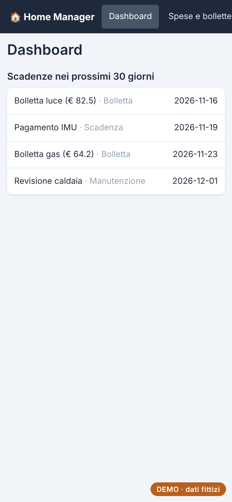

# Home Manager

Gestionale domestico: spese e bollette, scadenze, inventario della casa, lista della spesa e documenti, con un assistente che risponde sui propri dati.

**[Prova la demo](https://andreapollastrelli95.github.io/home-manager-demo/)** · dati fittizi, salvati solo nel tuo browser; nella demo l'assistente AI è disattivato.



## Cosa fa

- **Dashboard** con le scadenze dei prossimi 30 giorni.
- **Spese e bollette** con categorie, scadenza e stato di pagamento.
- **Inventario** per stanza, **lista della spesa** e archivio dei **documenti** con scadenza.
- **Assistente**: domande in linguaggio naturale sui dati dell'app (Google Gemini).
- **Backup**: esportazione e importazione JSON con controllo del file e copia di sicurezza prima di sostituire i dati.
- Ricerca in ogni elenco, conferma prima di eliminare, interfaccia pensata anche per il telefono.

| Spese e bollette | Scadenze | Telefono |
|---|---|---|
|  |  |  |

## Come è fatto

React, TypeScript, Vite, Tailwind CSS, Dexie (IndexedDB), React Router; server Node per sincronizzare i dati tra PC e telefono; Electron per la versione desktop.

I dati vivono nel browser (IndexedDB) e vengono sincronizzati con un archivio centrale tramite `/api/data`, con controllo di versione per non sovrascrivere le modifiche fatte da un altro dispositivo. Nella demo `public/demo-api.js` sostituisce il server con un archivio locale che segue le stesse regole.

## Avviarlo in locale

```bash
npm install
npm run dev      # sviluppo
npm run build    # versione web in dist/
```

---

Progetto di [Andrea Pollastrelli](https://andreapollastrelli95.github.io/).
